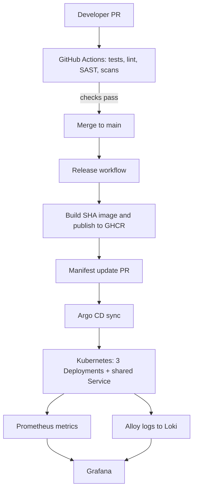

# DevSecOps & Site Reliability Engineering Assessment

**Repository:** https://github.com/shreya1302/DevOps-SRE  
**Environment:** Windows 11, Docker Desktop Kubernetes, PowerShell  
**Application:** Python HTTP microservice with an intentional memory leak  
**Stack:** Docker, GitHub Actions, GHCR, Kubernetes, Argo CD, Helm, Prometheus, Grafana, Loki and Grafana Alloy.

## Objective
Build a secure delivery pipeline, deploy three image versions through GitOps, and monitor application health, resource usage and logs. The application container memory limit is explicitly **400Mi**, as required by the assessment.

## Architecture


## Implemented
- Minimal Python 3.12 slim-based Docker image, non-root runtime and health check.
- PR workflow: pytest, Flake8, Bandit, Docker build, Trivy and Gitleaks.
- Protected `main` branch: PR required and `Test and Code Quality` required status check.
- Release workflow publishes SHA-tagged images to `ghcr.io/shreya1302/devops-sre-app` and opens a manifest update PR.
- Argo CD tracks `main`, path `k8s/base`, with automated sync, pruning and self-healing.
- Three Deployments (`v1`, `v2`, `v3`) and one shared Service.
- Namespace, ConfigMap, demo Secret, initContainer, RBAC, NetworkPolicy manifest and ResourceQuota.
- Application memory request `128Mi`, limit `400Mi`; OOMKilled events with exit code 137 were observed.
- Prometheus/Grafana Helm setup, dashboard and alert rules; Alloy/Loki log aggregation configured.

## Repository areas
`app/`, `test/`, `.github/workflows/`, `k8s/base/`, Dockerfile, and Helm values files `monitoring-values.yaml`, `loki-values.yaml`, `alloy-values.yaml`.

## Important validation qualification
Earlier validation showed a populated Grafana dashboard and a Loki Explore query returning 194 log lines. However, the latest captured cluster output on 31 October 2026 showed the `monitoring` Helm release as `failed`, Grafana at `2/3` containers ready and Prometheus still initializing. Revalidate monitoring before claiming the stack is currently healthy.

## Known gaps
- Earlier Trivy result: 44 HIGH, 0 CRITICAL; HIGH findings remain to review.
- NetworkPolicy manifest applied, enforcement not verified with local `kindnet`.
- Node disk usage panel skipped because the query returned no data.
- Loki filesystem storage used `/tmp` with persistence disabled.
- Grafana alert rules saved, but no notification contact point configured.
- Dashboard and alert rules were created in Grafana UI and should be exported/provisioned into Git.
- Local resource pressure caused intermittent monitoring readiness/restarts.

## Quick checks
```powershell
git status
kubectl config current-context
kubectl get applications -n argocd
kubectl get deployments,pods,svc -n devops-sre
kubectl get pods -n monitoring
helm list -n monitoring
```

## Documents
- [Architecture](docs/architecture.md)
- [Setup and installation](docs/setup-and-installation.md)
- [Docker and CI/CD](docs/docker-and-cicd.md)
- [Kubernetes and Argo CD](docs/kubernetes-and-argocd.md)
- [Monitoring, logging and alerting](docs/monitoring-logging-alerting.md)
- [Testing and validation](docs/testing-and-validation.md)
- [Known limitations and improvements](docs/known-limitations-and-improvements.md)
- [Final assessment report](docs/final-assessment-report.md)
