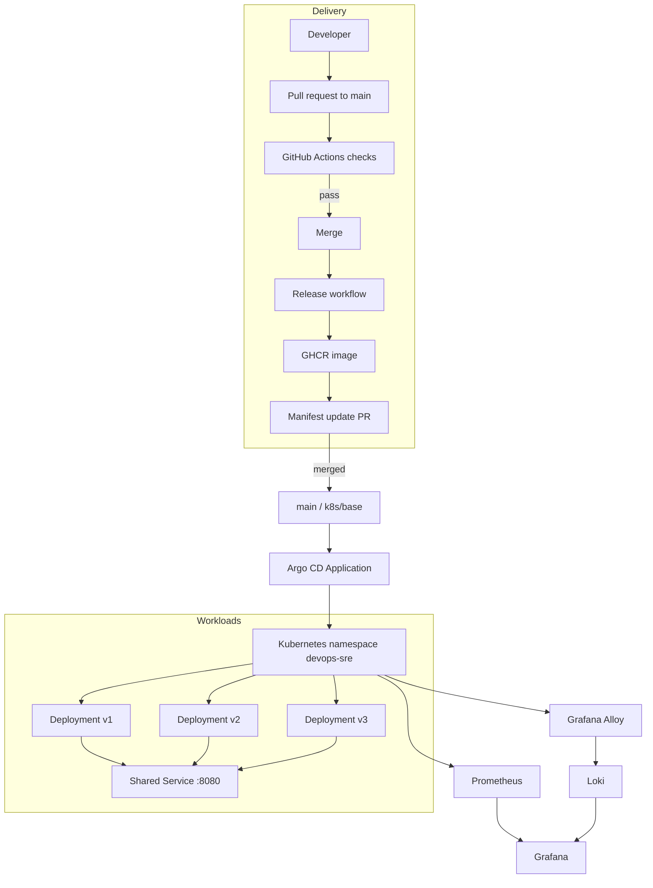

# Architecture

## End-to-end

## Components and responsibilities
| Component | Responsibility |
|---|---|
| GitHub | Source control, pull requests, branch rules |
| GitHub Actions | Test, lint, SAST, secret and image scanning; release |
| GHCR | Stores immutable SHA-tagged images |
| Argo CD | Git-to-cluster reconciliation |
| Kubernetes | Runs three versions and shared Service |
| Prometheus | Scrapes metrics |
| Grafana | Dashboards, Explore and alert evaluation |
| Alloy | Discovers Pod logs and forwards them |
| Loki | Central log storage/query |

## Recorded topology
- Argo CD Application: `devops-sre-app`
- Repository: `https://github.com/shreya1302/DevOps-SRE.git`
- Revision: `main`; path: `k8s/base`; namespace: `devops-sre`
- Auto-sync, prune and self-heal enabled.
- Deployments: `devops-sre-app-v1`, `-v2`, `-v3`.
- Shared Service: `devops-sre-app-service`, port 8080; recorded ClusterIP `10.96.59.47`, NodePort `30779`.
- App request `128Mi`, limit `400Mi`.

A manual scale drift was reverted by Argo CD. A merged ConfigMap update was reflected in the cluster through GitOps reconciliation.
